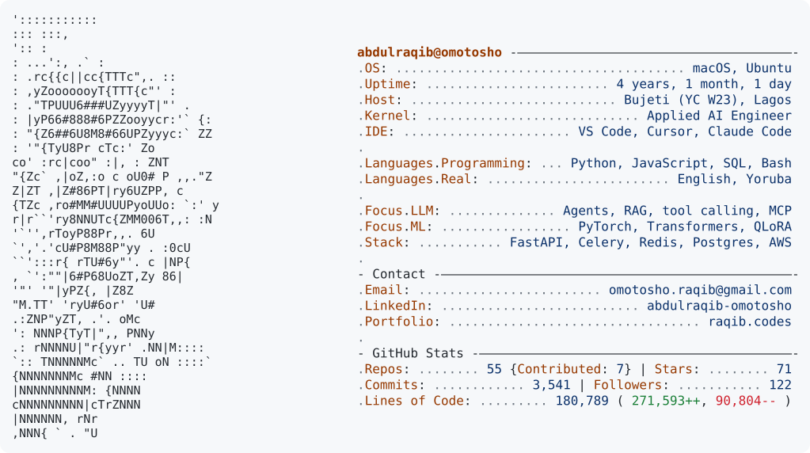
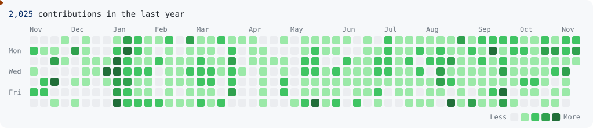

<a href="https://www.raqib.codes/">
  <picture>
    <source media="(prefers-color-scheme: dark)" srcset="https://raw.githubusercontent.com/Abdulraqib20/Abdulraqib20/main/dark_mode.svg">
    
  </picture>
</a>

<a href="https://www.raqib.codes/"><picture><source media="(prefers-color-scheme: dark)" srcset="https://raw.githubusercontent.com/Abdulraqib20/Abdulraqib20/main/link_portfolio_dark.svg"></picture></a><a href="https://linkedin.com/in/abdulraqib-omotosho"><picture><source media="(prefers-color-scheme: dark)" srcset="https://raw.githubusercontent.com/Abdulraqib20/Abdulraqib20/main/link_linkedin_dark.svg"></picture></a><a href="mailto:omotosho.raqib@gmail.com"><picture><source media="(prefers-color-scheme: dark)" srcset="https://raw.githubusercontent.com/Abdulraqib20/Abdulraqib20/main/link_email_dark.svg"></picture></a>

<picture>
  <source media="(prefers-color-scheme: dark)" srcset="https://raw.githubusercontent.com/Abdulraqib20/Abdulraqib20/main/pacman_dark.svg">
  
</picture>
